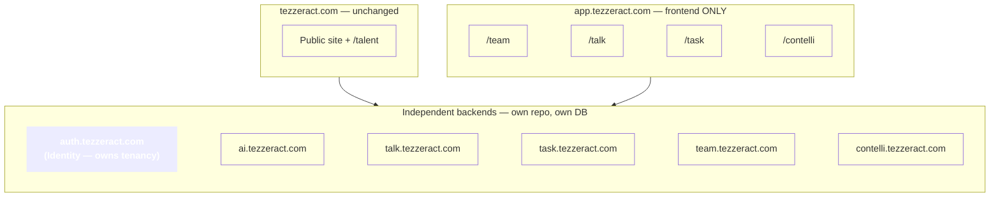
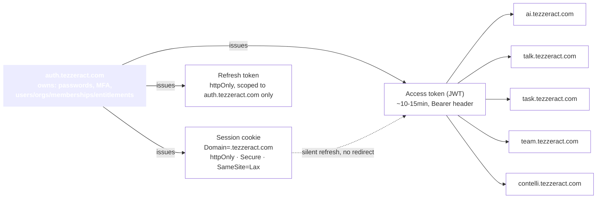
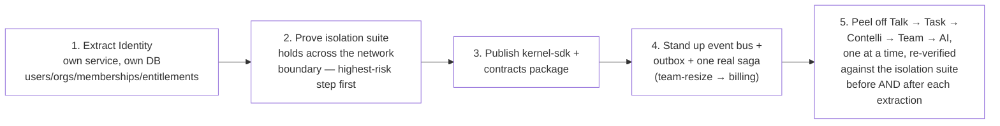

# Architecture v3 — Distributed Topology

> Written after leadership finalized a longer-horizon direction: `tezzeract.com` (public +
> talent) stays as-is; `app.tezzeract.com` becomes frontend-only; each product — AI, Talk,
> Task, Contelli, Team — gets its **own backend, own repo, own database**, reachable at its
> own subdomain. This reverses [ADR-001](10-decisions.md#adr-001) and
> [ADR-015](10-decisions.md#adr-015) on the exact triggers those records named: real hiring
> plans for dedicated AI/data/frontend teams, and Talk's message-volume argument for its own
> datastore. Supersedes those two records' *scope*, not their reasoning — the triggers fired.

---

## 1. The topology



`auth.tezzeract.com` is drawn distinctly on purpose: it is the one node in this diagram
that must never be "just another backend." Everything below assumes it stays the sole
owner of `users` / `organizations` / `memberships` / `entitlements` / `audit_log` —
identical scope to the platform schema in [12-data-model.md](12-data-model.md), now
physically its own service rather than a schema in a shared Postgres.

## 2. What's right about this direction

- **[ADR-001](10-decisions.md#adr-001)'s own reversal trigger** — *"many external
  contributors, or dedicated teams per module"* — has fired if AI/data/frontend hiring is
  real, not hypothetical.
- **[ADR-015](10-decisions.md#adr-015)'s trigger** — *"separate teams blocked on each
  other's release trains"* — same answer, same evidence required before acting.
- **Talk's data-volume argument** for its own datastore, independent of team-scaling
  reasoning, was always legitimate — [ADR-012](10-decisions.md#adr-012) already flagged
  realtime fan-out as the hardest component to run well.

The risk in this document is not "should we do this" — it's "seven specific ways this
breaks the tenancy and isolation model if executed without the mitigations below."

## 3. Risk 1 — SSO across independently-run backends

**The failure mode.** "Each backend supports main auth/user login" (as stated) means five
password stores, five session-expiry policies, five places a login bug can occur instead
of one. That is not SSO — SSO is one identity, verified everywhere.

**The fix — one issuer, everyone else verifies only.**



Because every subdomain shares `tezzeract.com`, the session cookie set with
`Domain=.tezzeract.com` is visible to all of them automatically — **silent re-auth needs no
redirect dance**, unlike a genuinely separate eTLD (e.g. a future `contelli.co`). A
subdomain's frontend calls `auth.tezzeract.com/token` with `credentials: 'include'` and gets
a fresh access token with no login prompt.

Every other backend runs the same ~20 lines, sourced from a shared library, never
reimplemented:

```ts
// @tezzeract/kernel-sdk — one implementation, imported by every backend
export async function verifyRequest(req): Promise<OrgContext> {
  const token = extractBearer(req);
  const claims = await verifyJWT(token, JWKS_URL);   // signature + exp, cached JWKS
  return {
    userId: claims.sub,
    standing: claims.standing,
    orgIds: claims.orgs.map(o => o.id),
    roleByOrg: Object.fromEntries(claims.orgs.map(o => [o.id, o.role])),
    entitlements: claims.ent,
  };
}
```

No backend touches a password. No backend maintains a session. That is the whole fix, and
it must be non-negotiable across every team that builds one of these services.

**Revocation.** Access tokens are short-lived by design (accepted blast radius: 10–15 min).
For faster cutoff, `refresh` checks live membership status before minting the next token —
revocation takes effect within one refresh cycle, without adding a DB round-trip to every
request.

## 4. Risk 2 — five databases fragmenting "who can access what"

**The failure mode.** If each backend holds its own copy of orgs/users/memberships, a
membership revoked in one system stays valid in another until some sync job catches up.
Five independent implementations of "does this user belong to this org" means the isolation
guarantee is only as strong as the worst one.

**The fix.** Platform tables stay in exactly one place — `auth.tezzeract.com`'s own
database. Every other backend's database holds only its own module data plus opaque
`organization_id` / `user_id` references, never a duplicated tenancy graph.
`OrgContext` resolves from signed token claims (cheap, no network call) or a cached lookup
against Identity for anything that can't wait for the next token refresh.

**This doesn't retire [ADR-004](10-decisions.md#adr-004) (RLS + `organization_id`), it
relocates what it applies to.** Every backend's own database still carries
`organization_id` on every tenant-scoped row, with RLS as the same defence-in-depth
backstop — just now enforced *inside each service's own database independently*, rather
than one shared Postgres instance. A `talk.tezzeract.com` row still can't leak across orgs
within Talk's own database for exactly the reason it couldn't before; there are just five
databases enforcing that property now instead of one.

**Different access per app is not a contradiction of SSO — it's the point.** One token
carries everything; each app decides independently what the claims mean for *its* own
resources:

```jsonc
{
  "sub": "usr_01H…",
  "standing": "tezzeract_internal",
  "orgs": [{ "id": "org_abc", "role": "org_admin" }, { "id": "org_xyz", "role": "org_manager" }],
  "ent": { "org_abc": ["talk", "task", "team"], "org_xyz": ["talk", "contelli"] }
}
```

```ts
// talk.tezzeract.com                          // task.tezzeract.com — same claims,
if (!ctx.ent[orgId]?.includes('talk')) 403;     // different rule for the same role
if (rank(ctx.roleByOrg[orgId]) < 'org_staff')   if (!ctx.ent[orgId]?.includes('task')) 403;
  403;                                          if (rank(...) < 'org_staff') 403; // create
if (rank(...) < 'org_manager') 403; // create   if (rank(...) < 'org_manager') 403; // delete
```

`org_manager` doesn't need to mean the same permission in Talk and Task — each app maps the
same three-level vocabulary onto its own resources, with zero cross-team coordination beyond
agreeing the vocabulary. What must stay centralized is only the **entitlement gate** and the
**role claim** — both sourced from Identity, both unforgeable downstream.

## 5. Risk 3 — agent isolation across five independently-built APIs

**The failure mode.** The property that `organizationId` is structurally unrepresentable as
a model input currently lives in one codebase's tool dispatcher. Distributed across five
teams' APIs, one team's endpoint accepting an org id as a plain parameter is a full
cross-tenant breach — and it is exactly the finding a security review leads with for an
"AI-first" platform.

**Mitigations, layered:**

1. **CI lint, shared across every repo**, fails the build if any tool's input schema
   contains a field named `organizationId` / `orgId` / `tenantId`:

   ```ts
   // @tezzeract/kernel-contracts-lint
   const forbidden = ['organizationId', 'orgId', 'tenantId', 'org_id'];
   if (forbidden.some(f => f in schema.shape))
     throw new Error('Org must be injected server-side — never a tool parameter.');
   ```

2. **The org is decided once, at the orchestrator, never re-decided downstream.**
   `ai.tezzeract.com` resolves `OrgContext` once per turn, then forwards the **same user
   token unmodified** to whichever backend a tool targets. Every backend re-verifies it
   independently — nobody downstream trusts "the orchestrator already checked this."

3. **The isolation suite becomes a federated, mandatory deploy gate**, not five separate
   nightly jobs. One central harness seeds two orgs across all five backends, auto-discovers
   each service's tool catalog via an introspection endpoint, and calls every tool as both
   orgs asserting zero cross-org visibility. **No tool goes live in the agent's catalog
   until the aggregate suite has passed against it.**

4. **No service-to-service database access, ever.** `ai.tezzeract.com` only calls public
   APIs with a forwarded, verified token — never a direct DB shortcut, which is exactly the
   kind of thing added under deadline pressure that becomes a permanent bypass.

5. **One shared trace id across all five services** (OpenTelemetry, one collector), so an
   incident review can reconstruct one agent turn without archaeology across five log
   stores. This is infrastructure the isolation guarantee depends on being *provable*, not
   a nice-to-have — stand it up before the split, not after.

## 6. Risk 4 — cross-module workflows become genuinely distributed

**The failure mode.** Team-resize → billing-proration, and "the agent creates a Talk thread
from a Contelli insight," both cross a database boundary now. Both need working
infrastructure to exist *before* they can ship at all, not as a later nice-to-have.

**The fix, concretely:**

- **Event bus: NATS JetStream**, not the provisional Redis Streams from
  [ADR-011](10-decisions.md#adr-011) — real consumer groups, replay, at-least-once
  delivery, materially less ops burden than Kafka. Upgrade to Kafka only on a measured
  volume/replay trigger, not by default.
- **Transactional outbox is mandatory per service.** Every publish happens in the same DB
  transaction as the state change it describes — the standard defence against "changed
  state but forgot to publish" and "published but the transaction rolled back," both far
  more likely once services are genuinely separate.
- **Event schemas are a published, versioned package**, same discipline as API contracts
  (§7) — a compatibility check in CI, additive-only within a major version.
- **Idempotent consumption, built into `@tezzeract/kernel-sdk`.** At-least-once delivery
  means every consumer must dedupe on event id — one shared helper, not five hand-rolled
  (and probably buggy) implementations.
- **Decide, explicitly, per saga, which side wins on partial failure.** For team-resize →
  billing: if Stripe proration fails, the correct behavior is *not* to roll back the team
  change — that surprises the customer over a billing hiccup. Correct behavior: alert ops,
  retry, let the team change stand. Document this choice next to each saga; "just roll
  back" is the default engineers reach for and is usually wrong for user-facing state.
- **Cache denormalized reads locally; never cache access-control data.** Talk showing an
  org's display name can read from a local copy fed by `organization.updated` events.
  Entitlement and membership checks stay live (or token-claim-fresh) always.
- **Track saga state on the initiating record**, not with a workflow engine yet — a status
  column (`pending → billing_updated → complete` / `→ failed → needs_attention`) plus an
  alert on anything stuck past N minutes. Reach for Temporal or Restate only past ~5–10
  distinct multi-step sagas — before that it's operational weight without a matching need.

**Sequencing.** Stand up the bus + outbox + one real saga (team-resize → billing, the
lowest-stakes existing example) *before* extracting Talk/Task/Contelli/Team — prove the
pattern on something low-stakes before the higher-stakes agent-driven flows depend on it.

## 7. Risk 5 — CORS, cookies, CSRF across five origins

Ship one shared middleware, not five independent configs:

```ts
// @tezzeract/kernel-sdk/http
export const tezzeractCors = cors({
  origin: ['https://app.tezzeract.com', 'https://tezzeract.com'], // explicit, never reflected
  credentials: true,
  maxAge: 86400,
});
```

The exposure is smaller than it first looks: actual API calls carry the access token as an
`Authorization: Bearer` header, not a cookie — a forged cross-site form cannot set that
header, so CSRF does not apply to them. The **only** cookie-authenticated endpoints are
`/token` and `/refresh` on `auth.tezzeract.com`. Scope the fix there:
`SameSite=Lax` on the session cookie, and the refresh-token cookie scoped to
`auth.tezzeract.com` only — never the wildcard `.tezzeract.com` domain — so a compromised
subdomain cannot read it. Baseline security headers (HSTS, `X-Content-Type-Options`, …) live
in the same shared middleware.

## 8. Risk 6 — contract drift across repo boundaries

**The fix: `@tezzeract/contracts`**, published from its own small dedicated repo — not a
full monorepo, just shared base schemas and codegen scripts every backend's own domain
schemas extend from:

```ts
export const Money = z.object({ amount: z.number(), currency: z.literal('USD') });
export const Envelope = <T>(data: z.ZodType<T>) =>
  z.object({ data, meta: z.object({ requestId: z.string(), traceId: z.string() }) });
export const OrgContext = z.object({ userId: z.string(), orgIds: z.array(z.string()) /* … */ });
```

Each backend publishes its own contract package on every merge to main (semver via
Changesets); `app.tezzeract.com` and `ai.tezzeract.com` pin versions deliberately, bumped
via Dependabot/Renovate PRs, never floating `latest`. Two CI gates, per repo:

1. **Codegen-drift** — regenerate the OpenAPI spec + Zod schemas from source, fail if
   committed output differs. Same principle as the monorepo check, now per-repo.
2. **Breaking-change gate** — diff the schema on any PR touching a contract; a removed
   field or new required field without a major bump fails the build.

## 9. Risk 7 — ops floor rises 3–5×, and someone has to own it

- **One shared Terraform module per service archetype**, instantiated with different
  parameters per team — not five hand-rolled deploy configs.
- **Reusable CI/CD workflow templates** (GitHub Actions reusable workflows) — every repo
  calls the same `deploy.yml`.
- **A minimal platform function, even one person part-time**, owning the shared Terraform
  modules, CI templates, the OTel collector, and `kernel-sdk` releases — must exist *before*
  the split.
- **Right-size per service.** Talk's message volume justifies real investment early;
  Team/Task/Contelli can start smaller. Uniformly copying the heaviest tier onto all five
  defeats the actual purpose of splitting them.
- **Tag every resource by service from day one**, with a per-service budget alert, so
  overspend is caught on a dashboard rather than discovered on the invoice.

**Rough cost shape.** Previously modeled ~$1.5–3.5k/month baseline on the monolith Kernel
approach at similar org counts. Five independently-run backends is closer to
**$5–12k/month baseline**, before inference (which dominates regardless of topology). Not a
reason not to do this if resourced for it — a number that should be a deliberate input, not
a month-one surprise.

## 10. Open items to resolve before finalizing

- **Naming collision:** the public "Talent" module at `tezzeract.com/talent` and the
  internal "Team" interface at `app.tezzeract.com/team` — same surface (public marketplace
  vs. authenticated management) or genuinely two products? Affects the agent's tool
  namespace (`talent.*` vs `team.*`).
- **Typo:** "Contelli → talk.tezzeract.com" in the original proposal should presumably read
  `contelli.tezzeract.com` — flagged before it propagates into DNS/infra config.

## 11. Sequencing — how to execute this without a risky big-bang rewrite



Because every module already depends only on the Kernel — never on another module, the CI
rule from [15-api-and-modules.md §1](15-api-and-modules.md) — each extraction should
genuinely approach the "afternoon" described in
[20-carve-out-readiness.md](20-carve-out-readiness.md). That principle was built for
exactly this moment: it is what makes this large a re-architecture safe to do
incrementally rather than as a rewrite.
